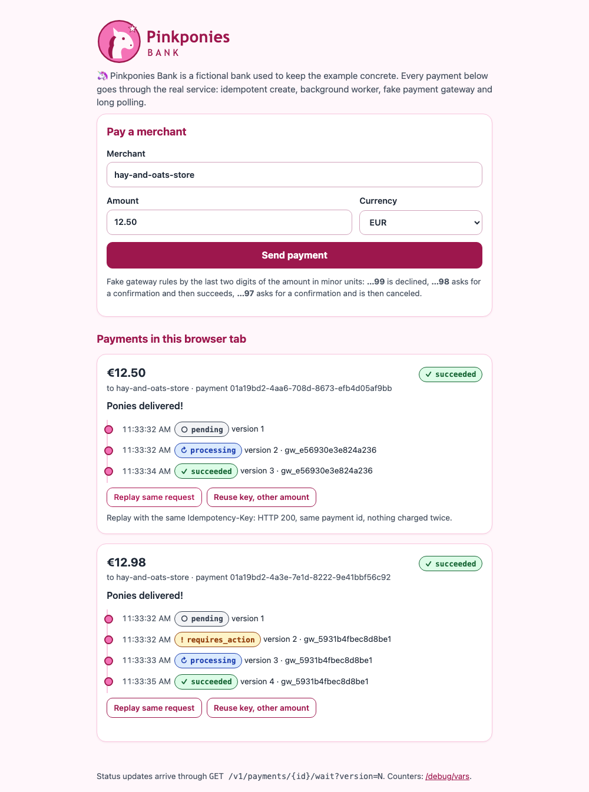
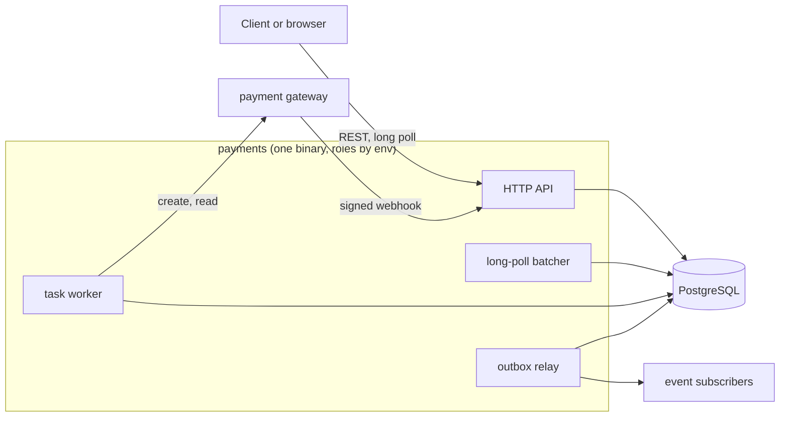

<p align="center"></p>

# go-payments-reference

Pinkponies Bank is a fictional bank used to keep the example concrete. Its
clients pay merchants, the money travels through an external payment
gateway, and nobody, pony or human, wants to be charged twice.

This repository is a small but complete payment service in Go. It shows
patterns commonly seen in production payment services: an idempotent API, a
PostgreSQL task queue with leases, a transactional outbox, polling as a
delayed retry, signed gateway webhooks, long polling with a shared batcher,
and an orderly shutdown. It also documents, honestly, where those patterns
hurt: [docs/REVIEW.md](docs/REVIEW.md) lists strengths and weaknesses with
references into the code, and [docs/IMPROVEMENTS.md](docs/IMPROVEMENTS.md)
is the plan for version 2.

It is the reference project of the learning site
[golang-interview-prep](https://aleksbeloushkin-srb.github.io/golang-interview-prep/):
the cards on Go services, data consistency, architecture and reliability
link to files here.

## Quick start

Requirements: Docker with Compose v2. Go 1.24 or newer for running tests.

```sh
docker compose up --build
```

Then open <http://localhost:8080>, pay a merchant and watch the status
change. Each card follows its payment through long polling; the buttons
replay the request with the same `Idempotency-Key` (200, same payment) and
reuse the key with another amount (422).

<p align="center"></p>

Or use curl:

```sh
# Create a payment. The Idempotency-Key makes the request safe to repeat.
curl -i -X POST localhost:8080/v1/payments \
  -H 'Idempotency-Key: demo-1' -H 'Content-Type: application/json' \
  -d '{"merchant_id":"hay-and-oats-store","amount_minor":1250,"currency":"EUR"}'
# 201 {"id":"<id>","status":"pending","version":1}
# The same request again returns 200 with the same id; the same key with
# another amount returns 422.

# Read it.
curl localhost:8080/v1/payments/<id>

# Long poll: answers as soon as the version is above 1, or after the soft
# timeout with "modified": false.
curl 'localhost:8080/v1/payments/<id>/wait?version=1'
# {"id":"<id>",...,"status":"processing","version":2,"modified":true}
```

The fake gateway listens on port 9090 and can misbehave on request:

```sh
curl -X POST 'localhost:9090/_control?faults=429,429'   # next two creates get 429 + Retry-After
curl -X POST 'localhost:9090/_control?faults=hang'      # executes, then never answers
curl -X POST 'localhost:9090/_control?faults=500'       # 500 before executing
curl -X POST 'localhost:9090/_control?faults=409,401'   # "same key in progress", then "bad credentials"
curl -X POST 'localhost:9090/_control?webhook=drop'     # or duplicate, or normal
curl -X POST 'localhost:9090/_control?latency=300ms'
curl localhost:9090/_control                            # current settings and counters
```

The last two digits of the amount in minor units pick the outcome: `..99`
is declined, `..98` needs a confirmation and then succeeds, `..97` needs a
confirmation and is then canceled; anything else succeeds.

`make e2e` starts the stack, runs all of this with curl and `jq`, checks
the results, and tears the stack down.

## Architecture



Ports and adapters: the domain and the use cases do not import HTTP, SQL or
the gateway client; adapters implement small interfaces declared by the code
that uses them; `cmd/payments/main.go` wires everything by hand. Details,
the data model and sequence diagrams for every flow are in
[docs/ARCHITECTURE.md](docs/ARCHITECTURE.md).

## Flows

1. **Create.** `POST /v1/payments` with an `Idempotency-Key`. One
   transaction inserts the payment (or finds the existing one for the key),
   a `start_payment` task and a `payment.created` event.
2. **Start.** The worker claims the task with a lease and calls the gateway
   with the payment id as the idempotency key. In version 1 this call runs
   inside the database transaction while the payment row is locked; that is
   the main deliberate weakness, explained in REVIEW.md.
3. **Poll.** Every payment that is not final has a `poll_payment` task,
   whichever path made it non-final. While the gateway reports a non-final
   status, the task is rescheduled. No goroutine sleeps.
4. **Webhook.** `POST /v1/gateway/events` checks the HMAC signature, stores
   the event as an `apply_gateway_event` task deduplicated by the gateway's
   event id, and answers 202.
5. **Status change.** Every change goes through the state machine, bumps
   `version` and writes a `payment.status_changed` event in the same
   transaction. The relay claims events with a lease and publishes them,
   at least once, with no transaction open.
6. **Wait.** `GET /v1/payments/{id}/wait?version=N` registers the client in a
   per-instance registry; one batcher checks all awaited payments with one
   query per tick.
7. **Shutdown.** Readiness off and no new tasks claimed, pause, HTTP drain,
   background components, pool.

## How to read the code

| Step | Where | What to look for |
| --- | --- | --- |
| 1 | [`internal/domain/payment`](internal/domain/payment) | `Payment`, `Money`, the transition table, `TransitionTo` |
| 2 | [`internal/ports`](internal/ports) | the interfaces the use cases need; error classes; `RetryLater` and `Permanent` |
| 3 | [`internal/app`](internal/app) | `create.go`, `start.go` (version 1 trade-off), `poll.go`, `event.go`, `query.go` (long poll), `status.go` |
| 4 | [`pkg/txctx`](pkg/txctx) | transaction in the context: `Run`, `DB`, `AfterCommit` |
| 5 | [`internal/adapters/out/postgres`](internal/adapters/out/postgres) | idempotent insert, claim with `SKIP LOCKED` and leases, fenced settle, outbox |
| 6 | [`internal/adapters/in/queue`](internal/adapters/in/queue) | claim loop, backoff with jitter, dead state, shutdown behaviour |
| 7 | [`internal/longpoll`](internal/longpoll) | registry, batcher, markers |
| 8 | [`internal/adapters/out/gateway`](internal/adapters/out/gateway) | per-call deadlines and the retry policy for ambiguous outcomes |
| 9 | [`internal/adapters/in/httpapi`](internal/adapters/in/httpapi) | middleware order, `writeError`, the wait handler, the webhook |
| 10 | [`cmd/payments/main.go`](cmd/payments/main.go) | composition root and shutdown order |
| 11 | [`cmd/fakegateway`](cmd/fakegateway) | fault injection |
| 12 | [`test/integration`](test/integration) | concurrency and transaction tests on a real database |

## Where each pattern lives

| Pattern | File |
| --- | --- |
| Idempotent create with a request hash | [`internal/app/create.go`](internal/app/create.go), [`internal/adapters/out/postgres/payments.go`](internal/adapters/out/postgres/payments.go) |
| Explicit state machine, no regress from final statuses | [`internal/domain/payment/status.go`](internal/domain/payment/status.go), [`internal/domain/payment/payment.go`](internal/domain/payment/payment.go) |
| Optimistic version check | [`internal/adapters/out/postgres/payments.go`](internal/adapters/out/postgres/payments.go) (`Update`) |
| Transaction in context, commit hooks | [`pkg/txctx/txctx.go`](pkg/txctx/txctx.go) |
| Task queue: `SKIP LOCKED`, lease, fencing token | [`internal/adapters/out/postgres/tasks.go`](internal/adapters/out/postgres/tasks.go) |
| Retries with backoff and jitter, dead-letter state | [`internal/adapters/in/queue/worker.go`](internal/adapters/in/queue/worker.go), [`backoff.go`](internal/adapters/in/queue/backoff.go) |
| Polling as a delayed retry | [`internal/app/poll.go`](internal/app/poll.go) |
| Gateway call inside a transaction (version 1 weakness) | [`internal/app/start.go`](internal/app/start.go) |
| Retry only what was not executed; decline only on explicit decline codes | [`internal/adapters/out/gateway/client.go`](internal/adapters/out/gateway/client.go) |
| Webhook signature with replay window | [`pkg/hmacsig/hmacsig.go`](pkg/hmacsig/hmacsig.go), [`internal/adapters/in/httpapi/events.go`](internal/adapters/in/httpapi/events.go) |
| Inbox deduplication by event id | [`internal/app/event.go`](internal/app/event.go) |
| Transactional outbox; relay that claims with a lease and publishes outside any transaction | [`internal/adapters/out/postgres/outbox.go`](internal/adapters/out/postgres/outbox.go), [`internal/adapters/in/outbox/relay.go`](internal/adapters/in/outbox/relay.go) |
| Every non-final payment has a poll task | [`internal/app/status.go`](internal/app/status.go) (`ensurePoll`) |
| Long polling with markers, cap and 429 | [`internal/longpoll`](internal/longpoll), [`internal/app/query.go`](internal/app/query.go) |
| Error to status code in one place | [`internal/adapters/in/httpapi/errors.go`](internal/adapters/in/httpapi/errors.go) |
| Middleware order: request id, logging, recover | [`internal/adapters/in/httpapi/middleware.go`](internal/adapters/in/httpapi/middleware.go) |
| Strict configuration with cross-checks | [`internal/platform/config.go`](internal/platform/config.go) |
| Graceful shutdown and goroutine ownership | [`cmd/payments/main.go`](cmd/payments/main.go), [`internal/platform/lifecycle.go`](internal/platform/lifecycle.go) |
| Fault injection | [`cmd/fakegateway/gateway.go`](cmd/fakegateway/gateway.go) |

## Tests

```sh
make test               # unit tests, -race, no Docker
make test-integration   # adds PostgreSQL tests via testcontainers (needs Docker)
make e2e                # whole stack with docker compose and curl
make lint               # gofmt, go vet, staticcheck if installed
```

Unit tests use in-memory fakes of the ports (with real rollback semantics),
`httptest` servers and injected clocks; none of them sleeps to synchronize.
Integration tests run against PostgreSQL 16 and cover idempotent creates
under concurrency, concurrent workers, lease expiry, dead tasks, the outbox
transaction, the state machine and long polling end to end. Everything runs
with `-race` on Go 1.24 and the latest Go release.

If Docker runs in a VM whose socket is not the default (for example colima),
point testcontainers at it:

```sh
export DOCKER_HOST=unix://$HOME/.colima/default/docker.sock
export TESTCONTAINERS_DOCKER_SOCKET_OVERRIDE=/var/run/docker.sock
```

## Troubleshooting

**Image builds stall on a VM-based Docker (for example colima on macOS).**
Some VM setups have a bridge network that stalls large downloads, so
`go build` inside the image never finishes fetching modules. A one-off,
local workaround is to build on the host network with a Compose override
file. Compose loads `compose.override.yaml` automatically, and
`.gitignore` keeps it out of commits:

```sh
cat > compose.override.yaml <<'EOF'
services:
  payments:
    build: { network: host }
  fakegateway:
    build: { network: host }
EOF
docker compose up --build
```

Compose versions that build through `buildx bake` also need the
`network.host` entitlement, for example
`docker compose build --print | docker buildx bake -f - --allow=network.host`.
Delete the override file once the network is fixed; it is not the default
on purpose.

## Configuration

All settings come from the environment and are validated at start: an
unknown `PAYMENTS_` variable, an unparsable value or an inconsistent
combination stops the process. The defaults are values chosen for this
reference service; each has its reason in
[`internal/platform/config.go`](internal/platform/config.go).

| Variable | Default | Purpose |
| --- | --- | --- |
| `PAYMENTS_DATABASE_URL` | required | PostgreSQL connection string |
| `PAYMENTS_GATEWAY_URL` | required for the worker role | gateway base URL |
| `PAYMENTS_WEBHOOK_SECRET` | required for the api role, 16+ bytes | gateway webhook HMAC key |
| `PAYMENTS_ROLES` | `api,worker,relay` | components to run in this process |
| `PAYMENTS_HTTP_ADDR` | `:8080` | listen address |
| `PAYMENTS_HTTP_READ_HEADER_TIMEOUT` / `_READ_TIMEOUT` / `_WRITE_TIMEOUT` / `_IDLE_TIMEOUT` | `5s` / `10s` / `25s` / `60s` | server timeouts; write must exceed the wait timeout and two wait reads by 5s |
| `PAYMENTS_SHUTDOWN_DRAIN_DELAY` / `_TIMEOUT` | `3s` / `15s` | pause after readiness turns off; HTTP drain limit |
| `PAYMENTS_DB_MAX_CONNS` | `12` | pool size; must exceed worker concurrency by 3 |
| `PAYMENTS_DB_STATEMENT_TIMEOUT` / `_LOCK_TIMEOUT` / `_IDLE_IN_TX_TIMEOUT` | `10s` / `5s` / `45s` | server-side limits per session |
| `PAYMENTS_GATEWAY_TIMEOUT` / `_MAX_RETRIES` / `_MAX_RETRY_AFTER` | `4s` / `2` / `5s` | per-call deadline and in-line retries for unexecuted requests |
| `PAYMENTS_WORKER_CONCURRENCY` / `_IDLE_INTERVAL` | `4` / `1s` | tasks run at once; claim cadence when idle |
| `PAYMENTS_TASK_LEASE` / `_TIMEOUT` / `_MAX_ATTEMPTS` | `60s` / `30s` / `12` | lease, handler deadline, attempts before the dead state |
| `PAYMENTS_TASK_RETRY_BASE` / `_RETRY_MAX` | `500ms` / `2m` | exponential backoff bounds |
| `PAYMENTS_POLL_INTERVAL` / `_POLL_TIMEOUT` | `3s` / `2h` | gateway polling cadence and give-up age |
| `PAYMENTS_WAIT_TIMEOUT` / `_READ_TIMEOUT` / `_MAX_WAITERS` / `_BATCH_INTERVAL` | `15s` / `2s` / `2000` / `200ms` | long-poll soft timeout, bound on each database read, per-instance cap, batcher tick |
| `PAYMENTS_RELAY_INTERVAL` / `_BATCH` / `_LEASE` | `500ms` / `50` / `1m` | outbox relay cadence, batch size, claim lease |
| `PAYMENTS_EVENTS_WEBHOOK_URL` / `_TIMEOUT` | empty / `5s` | optional subscriber for outbox events; per-delivery timeout (the lease must be at least twice as long) |
| `PAYMENTS_LOG_LEVEL` | `info` | `debug`, `info`, `warn`, `error` |

The fake gateway reads `GATEWAY_ADDR`, `GATEWAY_WEBHOOK_URL`,
`GATEWAY_WEBHOOK_SECRET`, `GATEWAY_SETTLE_DELAY`, `GATEWAY_LATENCY`,
`GATEWAY_RETRY_AFTER`, `GATEWAY_FAULTS` and `GATEWAY_WEBHOOK_MODE`.

## Dependencies

| Module | Version | Why |
| --- | --- | --- |
| `github.com/jackc/pgx/v5` | v5.8.0 | PostgreSQL driver and pool; native types, no `database/sql` overhead |
| `github.com/pressly/goose/v3` | v3.26.0 | SQL migrations embedded in the binary and applied at start under a lock |
| `github.com/google/uuid` | v1.6.0 | UUIDv7 payment ids |
| `golang.org/x/sync` | v0.19.0 | `errgroup` for the background components |
| `github.com/google/go-cmp` | v0.7.0 | readable diffs in tests |
| `github.com/testcontainers/testcontainers-go` | v0.40.0 | PostgreSQL for integration tests only |

Everything else is the standard library: `net/http` with Go 1.22 routing,
`log/slog`, `expvar`, `crypto/hmac`. The versions are the newest that still
support Go 1.24, which is the minimum version of this module.

## Documents

- [docs/ARCHITECTURE.md](docs/ARCHITECTURE.md): layers, dependency rule, data model, sequence diagrams
- [docs/REVIEW.md](docs/REVIEW.md): strengths and weaknesses with file and line references
- [docs/IMPROVEMENTS.md](docs/IMPROVEMENTS.md): the version 2 plan with effect, cost and risk per item; manual DI compared with wire and fx
- [docs/CONTEXT.md](docs/CONTEXT.md): how `context.Context` is used and misused
- [docs/EXTENDING.md](docs/EXTENDING.md): new gateway, new operation, new notification channel, scaling, versioning
- [docs/CHECKLIST.md](docs/CHECKLIST.md): a production checklist, marked against this repository

## License

MIT, see [LICENSE](LICENSE).
