# Architecture

This document describes how the service is put together: the layers and the
rule that connects them, the data model, and the main flows as sequence
diagrams. For the trade-offs of each decision see [REVIEW.md](REVIEW.md); for
the planned changes see [IMPROVEMENTS.md](IMPROVEMENTS.md).

## Components

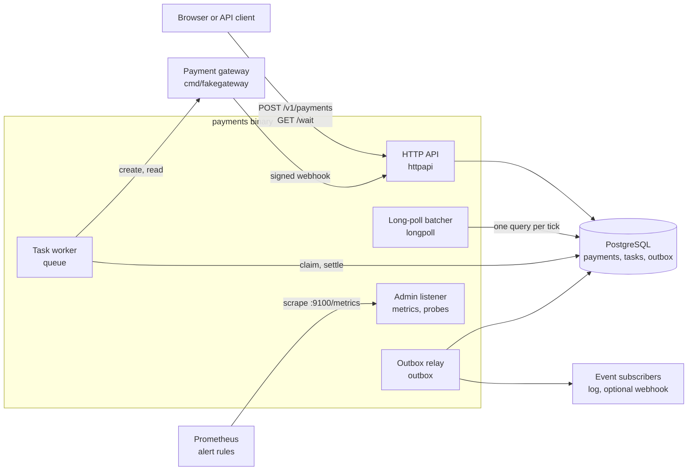

One binary runs four roles. `PAYMENTS_ROLES` selects which of them start, so
the same image can run as an API-only deployment, a worker-only deployment
and so on. The admin listener (`PAYMENTS_ADMIN_ADDR`, Prometheus metrics,
liveness and readiness) runs in every role; see
[OBSERVABILITY.md](OBSERVABILITY.md). All roles share one PostgreSQL database, which is the only
state: every instance is stateless apart from its in-memory long-poll
registry.

## Layers and the dependency rule

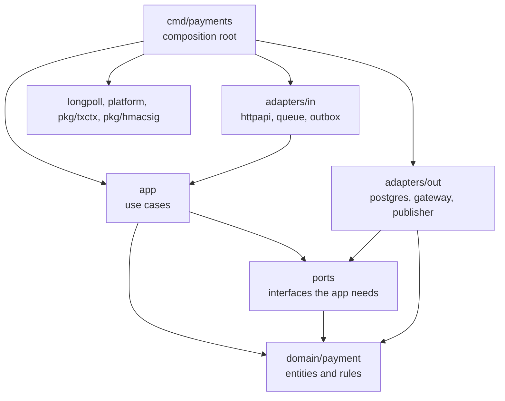

Dependencies point inwards. The domain imports nothing from the project. The
application layer imports only the domain and `ports`. Adapters implement the
port interfaces, and only `cmd/payments` knows every concrete type.

| Package | Role | Imports from the project |
| --- | --- | --- |
| `internal/domain/payment` | `Payment`, `Money`, the status machine, domain errors, events | nothing |
| `internal/ports` | interfaces declared for the use cases, and the data types and error classes that cross the boundary | `domain/payment` |
| `internal/app` | use cases and task handlers | `domain/payment`, `ports` |
| `internal/adapters/in/httpapi` | routes, middleware, error mapping, long-poll endpoint, webhook, static UI | `app`, `domain/payment`, `ports`, `platform`, `pkg/hmacsig` |
| `internal/adapters/in/queue` | claim loop, retries with backoff, dead state | `ports` |
| `internal/adapters/in/outbox` | relay from the outbox table to publishers | `ports` |
| `internal/adapters/out/postgres` | payments store, task queue, outbox store, migrations runner | `domain/payment`, `ports`, `pkg/txctx` |
| `internal/adapters/out/gateway` | HTTP client of the payment gateway with the retry policy | `domain/payment`, `ports` |
| `internal/adapters/out/publisher` | log and webhook publishers for outbox events | `ports` |
| `internal/adapters/out/metrics` | Prometheus implementation of the business metrics port | `domain/payment` |
| `internal/longpoll` | waiter registry and batcher | `ports` |
| `internal/platform` | configuration, logger, readiness, clock, background group | nothing |
| `pkg/txctx` | transaction carried in `context.Context` | nothing |
| `pkg/hmacsig` | webhook signatures | nothing |

Interfaces are declared by the consumer. The application declares
`ports.PaymentStore`, `ports.Gateway` and the rest; the HTTP adapter declares
the three small interfaces it needs from the application
(`PaymentCreator`, `PaymentReader`, `EventAccepter`); the worker declares
`Claimer`, `Settler` and `Handler`; the relay declares `Store` and
`Publisher`; the batcher declares `VersionReader`. No adapter exports an
interface "for others to implement".

## Data model

| Table | Columns | Notes |
| --- | --- | --- |
| `payments` | `id uuid pk`, `merchant_id`, `amount_minor bigint`, `currency`, `status`, `version bigint`, `gateway_ref null`, `idempotency_key unique`, `request_hash`, `created_at`, `updated_at` | `version` grows by one per status change |
| `tasks` | `id bigserial`, `kind`, `payment_id`, `dedup_key`, `payload jsonb`, `attempts`, `run_after`, `lease_until null`, `last_error`, `state` (`ready`, `done`, `dead`) | `unique (kind, payment_id, dedup_key)`, partial index on ready tasks |
| `outbox` | `id bigserial`, `payment_id`, `type`, `payload jsonb`, `created_at`, `published_at null`, `claimed_until null` | partial index on unpublished rows; `claimed_until` is the relay's lease |
| `gateway_attempts` | `payment_id`, `attempt`, `idempotency_key unique`, `state` (`intent`, `done`, `unknown`, `abandoned`), `gateway_ref null`, `not_found`, `created_at`, `updated_at` | primary key `(payment_id, attempt)`; a partial unique index allows one open (`intent`, `unknown`) attempt per payment |

Money is an integer number of minor units and an ISO 4217 code. Payment ids
are UUIDv7, so new rows land at the right edge of the primary-key index.

## Status machine

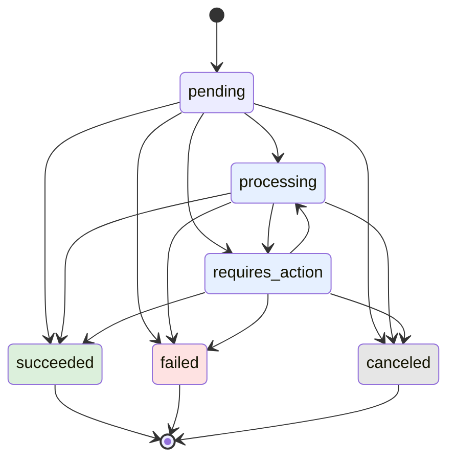

The table lives in `internal/domain/payment/status.go`. `Payment.TransitionTo`
is the only way to change a status. It treats "same status" as a no-op, so
duplicate events are harmless, and it rejects any move out of a final status.
When a gateway report is rejected, the application tells two cases apart: a
non-final status for a payment that is already final is stale and ignored;
two different final statuses are a real disagreement, and the task goes dead
for an operator. A report that names a different gateway reference than the
stored one also goes dead instead of being applied.

One invariant ties the state machine to the task queue: **a payment that is
not final always has a poll task.** Every transition to a non-final status,
and every retried start that finds the payment already started, enqueues
the poll task with the dedup key `poll`, so it exists exactly once. Webhooks
may be lost; polling is the safety net, however the payment got into its
current status.

## Flows

### Create a payment

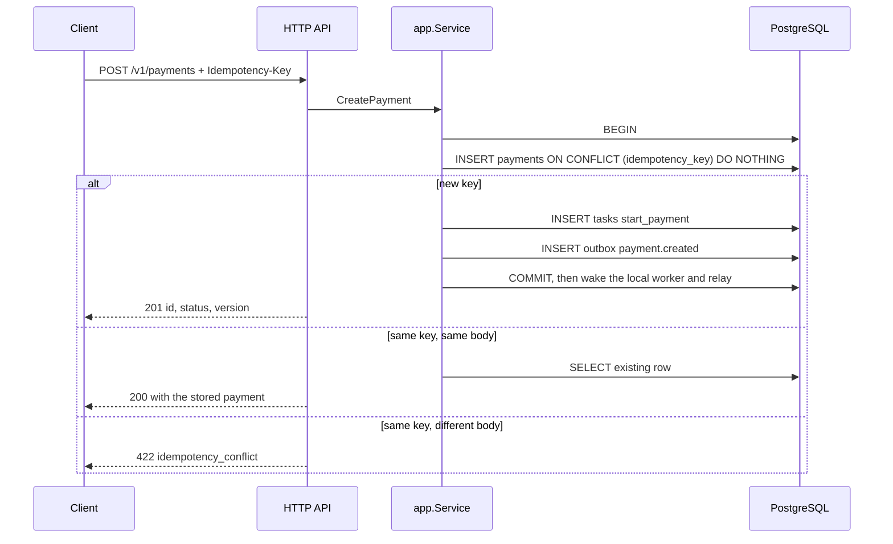

The payment, its start task and its event commit together, so there is never
a payment that nobody will start, nor an event about a payment that does not
exist.

### Start a payment (v2, `two_phase`: gateway call outside any transaction)

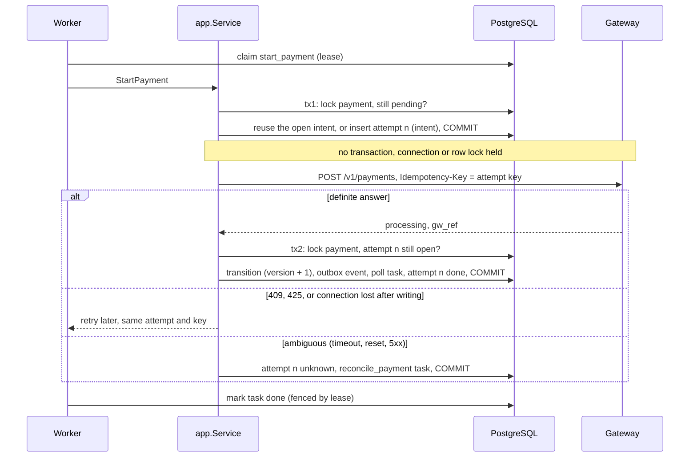

This is the default since v2 and the design of
[proposal 0001](proposals/0001-gateway-call-outside-transaction.md). The
attempt row is committed before the call, so after any crash the database
says which call may have happened and with which key. Attempt 1's key is the
payment id, the key of the v1 start, so the two modes deduplicate each
other's calls; later attempts use `<payment id>:<n>`. A gateway event that
arrives during or after the call is applied at once and closes the open
attempt; the late answer of tx2 does not move the payment back.

**Reconciliation.** `reconcile_payment` asks the gateway for the payments it
holds under our reference. One match is applied like tx2; a certain empty
answer is counted, and after `PAYMENTS_RECONCILE_NOT_FOUND_LIMIT` of them the
attempt is abandoned and a start task for attempt `n+1`, with a new key, is
enqueued, up to `PAYMENTS_MAX_GATEWAY_ATTEMPTS`; several matches send the task
dead for an operator. While an attempt is unknown, a start retry never calls
the gateway again.

**Duplicate check.** An attempt that follows an abandoned one may coexist
with a late payment for the abandoned key. When such an attempt settles, a
`check_duplicates` task looks the payment up after
`PAYMENTS_DUPLICATE_CHECK_DELAY`; more than one gateway payment counts
`gateway_duplicates_detected_total`, pages `GatewayDuplicateCharge` and goes
dead with the gateway references in the log. Refunding is an operator
action.

### Start a payment (v1, `in_tx`: gateway call inside the transaction)

Kept behind `PAYMENTS_START_MODE=in_tx` to compare the two.

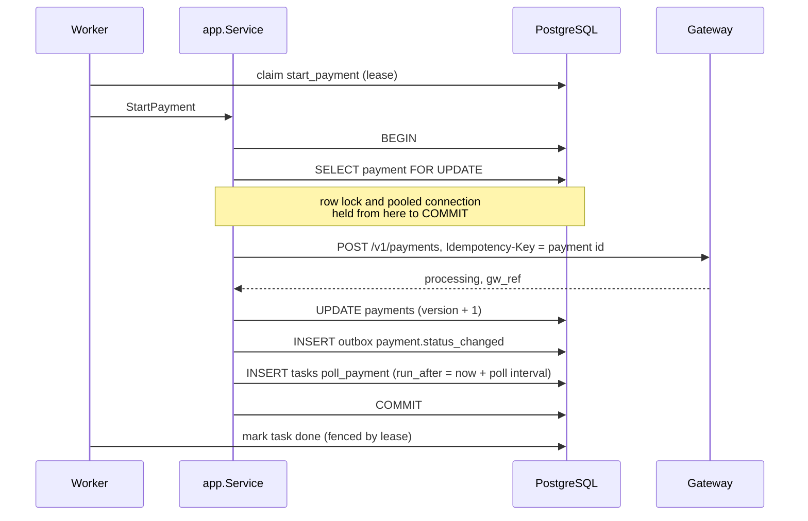

This was the deliberate weakness of version 1 (REVIEW.md, W1); the README
section "v1 to v2" shows its cost measured against the two-phase start.

### Poll a payment

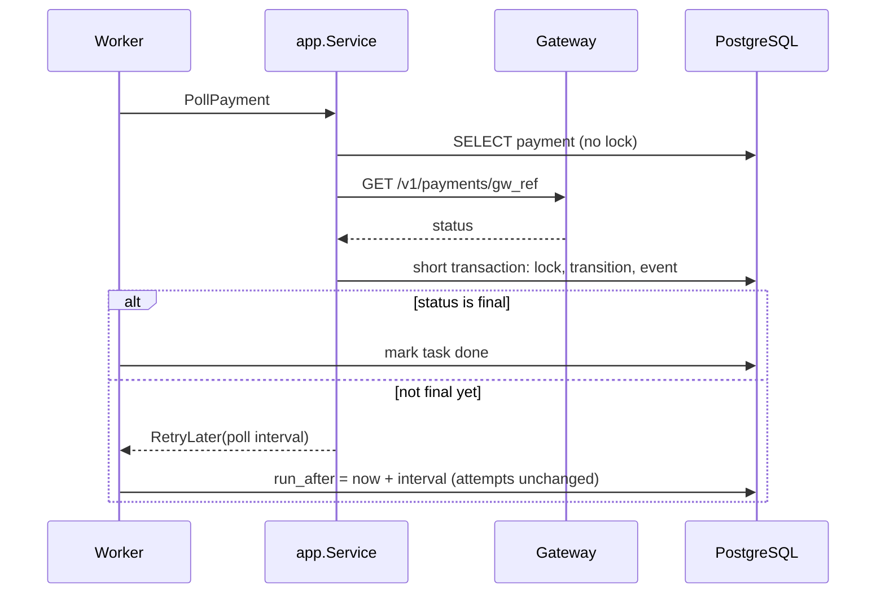

Polling is a delayed retry of the same task row. No goroutine sleeps, so a
restart loses nothing, and the gateway call happens outside any
transaction.

### Gateway webhook

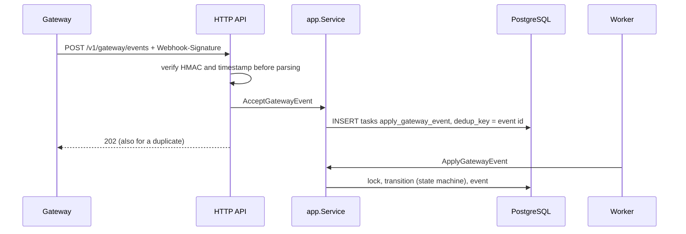

### Long polling

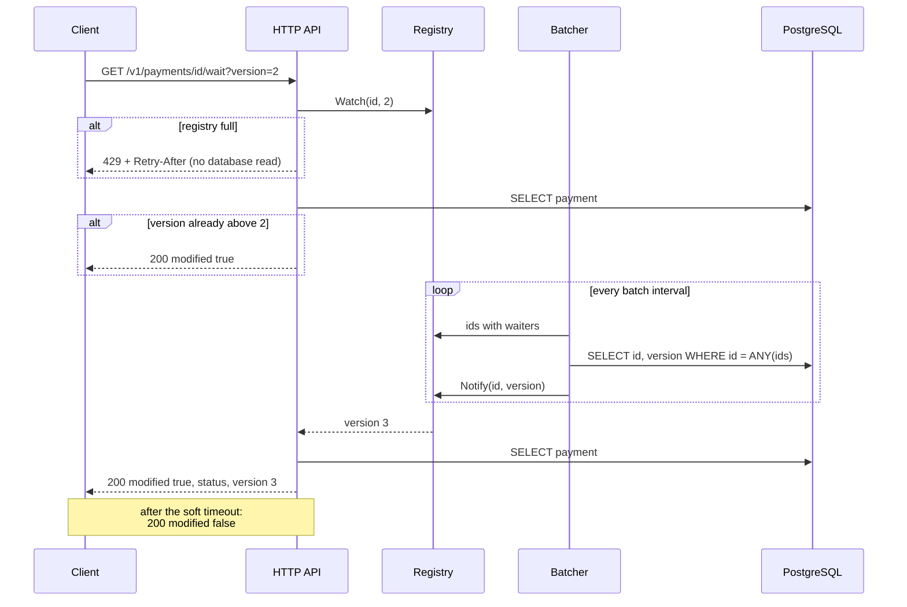

The client sends the version it has already seen. A waiter is woken only by
a strictly greater version, so the scheme is driven by markers, not by
messages:

- a change that happens between the client's read and its registration is
  still caught, because the batcher compares versions instead of waiting to
  be told about a change;
- a duplicate wake-up is harmless;
- if the batch query were moved to a read replica that lags behind, a waiter
  would be woken later, never wrongly: the replica can only report a version
  that the primary has already committed, and versions only grow. The
  follow-up read that builds the answer must then go to the primary (or to a
  replica that has caught up to the woken version), otherwise the client
  could get "modified" with an older body. This repository reads both from
  the primary.

The registry is per instance and capped (`PAYMENTS_WAIT_MAX_WAITERS`). The
HTTP server's `WriteTimeout` must exceed the soft timeout, and the
configuration loader refuses to start otherwise. On shutdown the registry is
closed first, so every open long poll answers "not modified" at once and the
drain does not wait for the soft timeout.

### Outbox relay

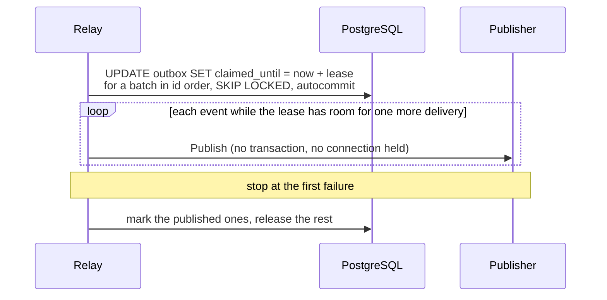

The claim is one statement that commits at once, so the relay never holds a
transaction or a row lock while a subscriber answers. Two relays claim
disjoint batches. A relay that crashes mid-batch leaves claims that expire,
and its events are claimed again. Delivery is at least once. Consumers deduplicate by the event id (the
`Event-ID` header of the webhook publisher) and use `version` to drop stale
events.

### Shutdown

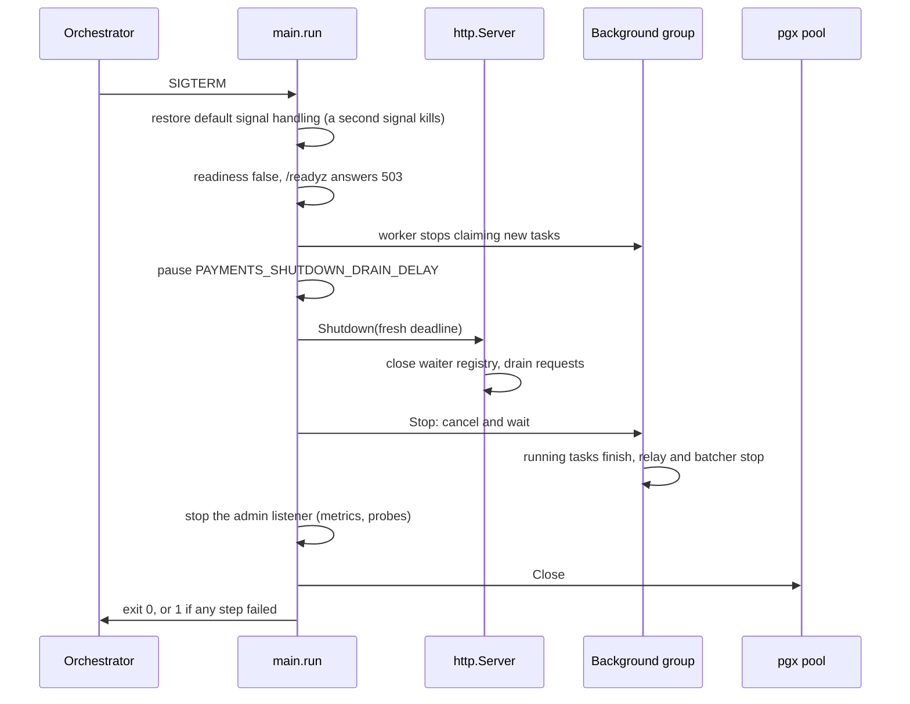

## Task queue mechanics

| Step | Statement | Why |
| --- | --- | --- |
| Enqueue | `INSERT ... ON CONFLICT (kind, payment_id, dedup_key) DO NOTHING` | idempotent; a duplicate never aborts the caller's transaction |
| Claim | `WITH batch AS MATERIALIZED (SELECT id ... FOR UPDATE SKIP LOCKED LIMIT n) UPDATE tasks SET lease_until = now + lease ... RETURNING` | concurrent workers skip each other's rows; the row lock lasts one statement, the lease covers the handler |
| Done | `UPDATE ... SET state = 'done' WHERE id = $1 AND lease_until = $2` | `lease_until` is a fencing token: a worker whose lease expired cannot overwrite the new owner |
| Retry | `attempts + 1`, `run_after = now + backoff` | exponential backoff with equal jitter |
| Postpone | `run_after = now + delay`, attempts unchanged | polling: "not final yet" is not a failure |
| Dead | `state = 'dead'` after `PAYMENTS_TASK_MAX_ATTEMPTS` or a permanent error | the dead-letter queue: logged at error level, visible as `tasks_dead` and alerted on (`DeadTasks`) |

Handlers report outcomes through error values from `ports`:
`ports.RetryLater` to postpone, `ports.Permanent` to give up, anything else
to retry with backoff. A `ports.RetryAfterError` (a rate-limited gateway)
is retried no sooner than the delay it carries.

With the defaults, a running task can need up to 35 s after shutdown starts
(the 30 s task timeout and the settle step), while the drain pause and the
HTTP drain take up to 18 s in parallel. Give the orchestrator a grace period
of at least 40 s.

## Transactions in the context

`pkg/txctx` keeps the open transaction in `context.Context`. Use cases call
`Run(ctx, fn)`; repositories call `Manager.DB(ctx)` and get the transaction
if there is one, the pool otherwise. A nested `Run` joins the outer
transaction. `AfterCommit(ctx, hook)` registers work that must happen only
after a durable commit; the task queue and the outbox use it to wake the
local worker and relay without waiting for their next poll. The package
comment lists the trade-offs, and [CONTEXT.md](CONTEXT.md) discusses them.
