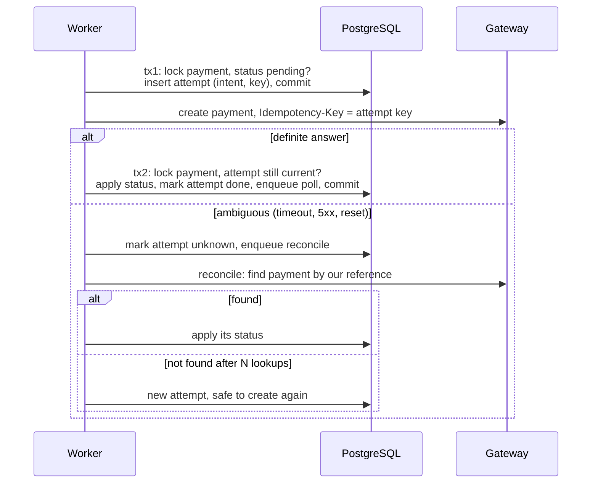

# Improvements: the version 2 plan

Version 1 uses a few simple designs on purpose, to show what they cost under
load. This plan replaces them one at a time. Each item
lists the change, the expected effect, the cost and the risk, and refers to
the weakness it fixes in [REVIEW.md](REVIEW.md) (W1, W2, ...).

Order matters: item 1 removes the main bottleneck and changes how ambiguous
outcomes are handled, which several later items build on.

| # | Change | Fixes | Effect | Cost | Risk |
| --- | --- | --- | --- | --- | --- |
| 1 | Gateway call outside the transaction, with a recorded intent | W1 | no connection or lock held during network I/O; ambiguous outcomes become explicit | medium | medium |
| 2 | Event-driven wake-up for long polling (LISTEN/NOTIFY) | W5 | wake-up in milliseconds instead of up to one batch interval | low to medium | low |
| 3 | Long-poll answers built from the batch query; jittered soft timeout | W5 | no read per woken waiter; no reconnect waves | low | low |
| 4 | Queue hardening: attempts at claim, continuous claiming, lease heartbeat, requeue tool | W2, W3 | poison tasks stop; no head-of-line blocking | medium | low |
| 5 | Retention and partitioning of `tasks` and `outbox` | W8 | bounded table and index size | medium | medium |
| 6 | Relay: a failing event blocks only its own payment (the lease and publishing outside any transaction are already done) | W7 | one broken event no longer halts the whole outbox | low | low |
| 7 | Ordering of non-final gateway statuses | W12 | no `processing` / `requires_action` flapping | low | low |
| 8 | Metrics and tracing | W15 and operations | alerts on dead tasks, queue lag and pool waits; traces across tasks | low to medium | low |
| 9 | Bulkhead and circuit breaker per gateway | after 1 | a failing gateway cannot take all workers | low | low |
| 10 | API hardening: scoped, expiring idempotency keys; admin port; authentication | W9, W10, W17 | multi-tenant safety | medium | low |
| 11 | Dependency injection: stay manual, or adopt wire or fx | none | see the comparison below | low | low |

## 1. Gateway call outside the transaction, with a recorded intent

Today `StartPayment` locks the payment row, calls the gateway and commits,
all in one transaction (`internal/app/start.go`). Version 2 breaks it into
two short transactions around the call, and records what it is about to do
before doing it.



Data: a `gateway_attempts` table (`payment_id`, `attempt`, `idempotency_key`,
`state` in `intent | done | unknown`, timestamps), or two columns on
`payments` if one attempt per payment is enough.

- **Expected effect.** No pooled connection and no row lock during the
  network call, so `PAYMENTS_WORKER_CONCURRENCY` is no longer tied to the
  pool size, webhooks for the same payment stop waiting on the lock, and a
  slow gateway slows down only its own payments. A crash between the
  gateway's success and our commit leaves an `intent` row that says exactly
  what to check, instead of a `pending` payment that looks untouched.
- **Cost.** Medium: a migration, a reconcile task kind, a gateway lookup by
  reference in the adapter, and a test for each crash point (before tx1
  commits, after tx1, after the call, before tx2 commits).
- **Risk.** Medium. It needs a gateway with idempotency keys or a lookup by
  reference; one with neither cannot be made safe by any client design. An
  extra intermediate state is visible to operators and must be documented.

## 2. Event-driven wake-up for long polling

The batcher queries every 200 ms whether or not anything changed. With
PostgreSQL's `LISTEN/NOTIFY`, the status-change transaction also runs
`SELECT pg_notify('payment_changed', id || ':' || version)`, which is
delivered only if the transaction commits. Each API instance keeps one
dedicated connection that listens and calls `Registry.Notify(id, version)`
directly. The batcher stays as a safety net at a slower interval (for
example every 2 seconds) for notifications lost during a reconnect.

- **Expected effect.** Wake-up latency drops from up to one batch interval
  to a few milliseconds; idle instances stop querying.
- **Cost.** Low to medium: a listener loop with reconnects, one extra
  connection per instance.
- **Risk.** Low. Notifications are not durable (hence the fallback), do not
  pass through transaction-mode connection poolers, and their payload is
  limited to 8000 bytes; under heavy write load the notification queue adds
  some commit overhead.

## 3. Long-poll answers from the batch query

Today a woken waiter reads the payment again to build its answer
(`internal/app/query.go`), so a status change watched by many clients costs
one read per client. The batch query can return the full rows of changed
payments and hand the snapshot to the waiters. Adding a random ±10 % to the
soft timeout spreads the reconnects of clients that started together.

- **Expected effect.** One query per tick in total, even on a mass wake-up.
- **Cost / risk.** Low. The registry starts to carry domain data instead of
  versions, which couples `longpoll` to the payment type; a generic
  `Registry[T]` keeps it clean.

## 4. Queue hardening

- **Count attempts at claim time** and keep a separate counter for
  postponements. Today an attempt is counted only when a handler returns, so
  a task that crashes the process (out of memory, a fatal runtime error) is
  re-claimed forever after each lease expiry.
- **Claim continuously.** `Worker.RunOnce` waits for the whole batch before
  claiming again, so one slow task holds back the others. A semaphore with
  `Concurrency` slots that claims as soon as a slot frees up removes the
  barrier.
- **Heartbeat the lease** for long tasks (extend `lease_until` while the
  handler runs), so the lease no longer has to be longer than the worst case.
- **Operate the dead-letter queue.** A command or admin endpoint to requeue
  dead tasks after a fix, and an alert on the `queue.dead` counter and on the
  age of the oldest ready task.

Effect: poison tasks surface within minutes; throughput does not depend on
the slowest task of a batch. Cost medium (claim statement, worker loop,
tests). Risk low; the claim statement is the hot path, so measure it.

## 5. Retention and partitioning

`done` tasks and published outbox rows stay forever. Short term, delete them
in small batches after a retention period. Longer term, partition both tables
by creation time (daily or weekly) and drop old partitions, which costs
nothing compared with `DELETE`. Tune autovacuum for `tasks`, whose rows are
updated several times each.

Effect: bounded table and index sizes, a claim query that stays fast. Cost
medium (migration of hot tables, partition management). Risk medium: the
unique dedup key must include the partition key, which changes what "duplicate"
means across partitions; decide the dedup window explicitly.

## 6. Relay: isolate a failing event

Done in the review fix pass: the relay claims a batch with a lease
(`claimed_until`), publishes with no transaction open, marks the published
events and releases the rest (`internal/adapters/in/outbox/relay.go`). A
slow subscriber no longer holds a connection or runs into the
idle-in-transaction limit.

Still open: the relay stops at the first failed event to keep each
payment's events in order, which also stops every other payment's events
behind it. Skip only the remaining events of the failed event's payment and
continue with the others.

Effect: one broken event no longer halts the whole outbox. Cost and risk
low.

## 7. Ordering of non-final statuses

The state machine allows `processing -> requires_action` and back, which is
correct, but a delayed `processing` event can arrive after a newer
`requires_action` one and move the payment back. Store the gateway's event
time or sequence number with the payment and ignore older reports.

Effect: no flapping of the status shown to the client. Cost and risk low.

## 8. Metrics and tracing

- Prometheus (or OpenTelemetry metrics) instead of `expvar`: request rate,
  errors and latency per route pattern; task lag (claim time minus
  `run_after`); attempts and outcomes per task kind; dead tasks; outbox lag;
  `pgxpool.Stat` for acquire waits; long-poll waiters per instance.
- OpenTelemetry tracing, with the trace context stored in the task payload
  and the outbox row so that a poll that runs an hour later links back to
  the request that created the payment (a span link, not one endless trace).

Effect: the alerts the checklist asks for. Cost low to medium. Risk low;
watch label cardinality (never put ids in labels).

## 9. Bulkhead and circuit breaker

After item 1, give each gateway its own concurrency limit and a circuit
breaker on start calls. When a gateway fails, its tasks back off without
using worker slots that other gateways need. Cost and risk low.

## 10. API hardening

- Scope idempotency keys per client and expire them (for example after 24
  hours), and store the original response so a replay returns exactly the
  same body.
- Move `/debug/vars` and other admin endpoints to a separate listener that
  is not exposed publicly.
- Authenticate API callers and check that a caller may see a payment
  (object-level authorization), and answer 404 rather than 403 for payments
  that belong to someone else, so ids cannot be probed.

## 11. Dependency injection: manual, wire or fx

The composition root in `cmd/payments/main.go` wires everything by hand. For
a graph of this size that is the right choice: a missing dependency is a
compile error, the start and stop order is visible in one function, and
there is nothing to learn beyond Go. The two common tools look like this on
the same graph. Both snippets are sketches, not compiled in this
repository: the helper providers (`providePool`, `newPool`, `newGateway`,
`newService`, the `register*` functions) are left out. The library calls
themselves are written in their correct form.

### google/wire (code generation)

```go
//go:build wireinject

package main

func initService(ctx context.Context, cfg platform.Config, log *slog.Logger) (*service, func(), error) {
	wire.Build(
		providePool, // returns (*pgxpool.Pool, func(), error); the func is pool.Close
		wire.Bind(new(txctx.Pool), new(*pgxpool.Pool)),
		txctx.New,
		wire.Bind(new(ports.TxRunner), new(*txctx.Manager)),
		postgres.NewPayments, wire.Bind(new(ports.PaymentStore), new(*postgres.Payments)),
		postgres.NewTasks, wire.Bind(new(ports.Enqueuer), new(*postgres.Tasks)),
		postgres.NewOutbox, wire.Bind(new(ports.EventRecorder), new(*postgres.Outbox)),
		provideGateway, // returns ports.Gateway
		provideRegistry, wire.Bind(new(ports.Watcher), new(*longpoll.Registry)),
		wire.Struct(new(platform.SystemClock)), wire.Bind(new(ports.Clock), new(platform.SystemClock)),
		wire.Value(uuid.NewV7),
		wire.Struct(new(app.Deps), "*"),
		provideAppConfig,
		app.NewService,
		newService, // assembles the HTTP server, worker and relay
	)
	return nil, nil, nil
}
```

`wire` generates `wire_gen.go`, which is ordinary Go code, the same function
you would write by hand. Graph errors (a missing provider, two providers of
one type) appear when the generator runs, not at start-up. It binds by type
only, so two values of the same type (a primary and a replica pool) need
distinct named types. It has cleanup functions but no lifecycle, so starting
and stopping the server and the workers stays hand-written. CI must check
that `wire_gen.go` is up to date. Check the project's maintenance status
before adopting it.

### uber/fx (runtime container with lifecycle)

```go
func main() {
	fx.New(
		fx.Supply(cfg, log),
		fx.Provide(
			// fx.As takes pointers to interfaces; fx.Self() also keeps the
			// concrete type available, because other constructors need it.
			fx.Annotate(newPool, fx.As(new(txctx.Pool)), fx.As(fx.Self())), // OnStart: Ping, OnStop: Close
			fx.Annotate(txctx.New, fx.As(new(ports.TxRunner)), fx.As(fx.Self())),
			fx.Annotate(postgres.NewPayments, fx.As(new(ports.PaymentStore))),
			postgres.NewTasks,
			postgres.NewOutbox,
			newGateway,
			newRegistry,
			newService,
		),
		fx.Invoke(registerHTTP),   // OnStart: listen and serve; OnStop: readiness off, Shutdown
		fx.Invoke(registerWorker), // OnStart: go worker.Run(ctx); OnStop: cancel and wait
		fx.Invoke(registerRelay),
	).Run()
}
```

Fx builds the graph by reflection when the process starts and owns the
lifecycle: start hooks run in order, stop hooks in reverse order, each with
a timeout, and a failed start rolls back what already started. The price is
that graph errors appear at start-up (cover them with a test that builds the
app with `fx.ValidateApp`), the graph is not visible in the code, and the
stop order follows the registration order, which is easy to break by
reordering `Invoke` lines. For a payment service, where "stop taking
requests, finish running tasks, then close the pool" is part of correctness,
that implicit order is a real risk.

### Recommendation

Stay manual until the graph has hundreds of components or several binaries
share large parts of it. Then prefer code generation (wire or a similar tool)
for its compile-time-like errors; choose fx when a platform team ships
reusable modules (logging, metrics, servers) to many services and the
lifecycle management is the main benefit.

- **Expected effect** of adopting either tool here: none on behaviour, less
  code in `main` only once the graph is much larger.
- **Cost.** Low to set up, ongoing for the team to learn.
- **Risk.** Low for wire (generated code can be read and even kept by hand),
  medium for fx (start-time errors and implicit stop order).
