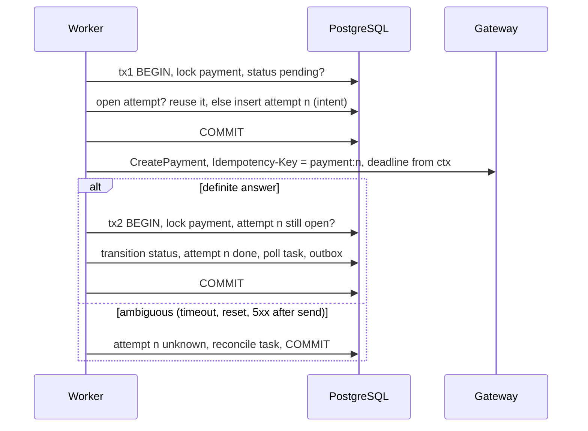

# Proposal 0001: call the gateway outside the database transaction

| | |
| --- | --- |
| Status | Proposed for v2 |
| Fixes | [REVIEW.md W1](../REVIEW.md) (deliberate v1 trade-off) |
| Summary in the plan | [IMPROVEMENTS.md, item 1](../IMPROVEMENTS.md) |
| Code today | [`internal/app/start.go`](../../internal/app/start.go) |

## Context

`StartPayment` runs one transaction: lock the payment row, call the gateway,
apply the answer, schedule the poll task, write the outbox row, commit. It is
easy to reason about: only one executor works on a payment, and the gateway
answer and its consequences commit together.

The price is paid while the network call is in flight:

| What is held | Consequence |
| --- | --- |
| A pooled database connection | Worker concurrency is capped by the pool size; a slow gateway drains the pool and API reads start waiting for connections |
| The payment's row lock | A webhook for the same payment blocks until the call returns; long-poll readers are fine, writers are not |
| The task lease | A call slower than the lease lets a second worker claim the task and call the gateway again |
| An open transaction | A crash after the gateway executed the payment but before our commit loses the answer; the payment looks untouched (`pending`) |

The last row is the dangerous one. A client of Pinkponies Bank pays a
merchant, the gateway moves the money, our process dies before the commit. On
retry we send the same idempotency key and the gateway, if it deduplicates,
returns the same payment. Correctness depends entirely on that gateway
behaviour, and nothing in our database says that a call may have happened.

## Goals

- No database connection, transaction or row lock is held during network I/O.
- Before the call, the database records that a call is about to happen and
  with which idempotency key.
- After any crash, the stored state says what to check next.
- The public API and the status machine stay the same; clients see no new
  statuses.

Non-goals: changing the poll or webhook flows, multi-gateway routing,
exactly-once delivery.

## Options considered

| Option | Idea | Verdict |
| --- | --- | --- |
| A. Two short transactions around the call, with a recorded attempt | tx1 records the intent and commits, the call runs with no transaction, tx2 applies the answer if the attempt is still current | **Chosen**: removes every held resource, makes the in-between state explicit, small change |
| B. Separate "submit" task after commit | the create path only enqueues; a submit task calls the gateway and enqueues an "apply" task | Same safety as A with one more queue hop and more latency; A can be extended to B later |
| C. Keep v1, add guard rails | separate pool for workers, call timeout shorter than the lease, lower concurrency | Mitigates the pool and lease rows, but not the lost-answer window; useful as a stop-gap only |
| D. Workflow engine | model start, poll and webhook as a durable workflow | Solves it with infrastructure the rest of the service does not need |

## Design

### Data

A new table, additive migration:

```sql
CREATE TABLE gateway_attempts (
    payment_id      uuid        NOT NULL REFERENCES payments (id),
    attempt         int         NOT NULL,
    idempotency_key text        NOT NULL UNIQUE,
    state           text        NOT NULL CHECK (state IN ('intent', 'done', 'unknown', 'abandoned')),
    gateway_ref     text,
    created_at      timestamptz NOT NULL DEFAULT now(),
    updated_at      timestamptz NOT NULL DEFAULT now(),
    PRIMARY KEY (payment_id, attempt)
);
CREATE INDEX gateway_attempts_open ON gateway_attempts (updated_at) WHERE state IN ('intent', 'unknown');
```

The idempotency key is `<payment id>:<attempt>`. It is stable for one attempt
and different for a deliberate new attempt.

### Flow



`reconcile` asks the gateway for the payment by our reference (or repeats
`CreatePayment` with the same key when the gateway deduplicates). If the
gateway knows it, the answer is applied as in tx2. If the gateway answers
"not found" with certainty after N lookups, the attempt becomes `abandoned`
and a new attempt `n+1` may be created.

### Where it can crash, and what happens

| Crash point | State left behind | Next step | Can the client be charged twice? |
| --- | --- | --- | --- |
| Before tx1 commits | nothing new | task retried, tx1 runs again | no |
| After tx1, before the call | attempt `intent`, no call made | task retried; it reuses the open attempt and its key | no: the first real call happens now |
| After the call, before tx2 | attempt `intent`, gateway may have executed | retry reuses the same key, or reconcile finds the payment | no, if the gateway deduplicates by key or supports lookup by reference |
| During tx2 | rolled back to `intent` | as the previous row | no |
| After tx2 | attempt `done`, status applied | nothing | no |

A gateway with neither idempotency keys nor lookup by reference cannot be
made safe by any client-side design; the proposal states this as a
precondition.

### Concurrency

- The task lease still guarantees one executor in the normal case. tx2
  re-locks the payment and applies the answer only if attempt `n` is still
  open, so a late duplicate worker cannot apply a stale answer.
- A webhook can arrive between tx1 and tx2. It is applied through the status
  machine as today. tx2 then sees the newer status, does not regress it, and
  only closes the attempt.
- The call deadline is derived from the task context and kept shorter than
  the lease, so a slow call ends before another worker may claim the task.

## Changes

| Area | Change |
| --- | --- |
| `migrations/` | `00003_gateway_attempts.sql` |
| `internal/ports` | `Attempts` port: open, reuse, close, mark unknown |
| `internal/app/start.go` | split into tx1, call, tx2; new `reconcile` task handler |
| `internal/adapters/out/gateway` | `FindByReference` when the gateway supports it |
| `internal/adapters/out/postgres` | attempts repository |
| `cmd/fakegateway` | fault "execute then drop the connection" (exists as "hang") and a lookup endpoint |
| Config | `PAYMENTS_START_MODE=in_tx|two_phase` during rollout |

## Tests

- Unit, with fakes, one test per crash point in the table above: each injects
  a failure at that point, restarts the handler, and asserts the final state
  and the number of gateway executions.
- Integration on PostgreSQL: two workers race on the same task with an
  expired lease; a webhook lands between tx1 and tx2; a connection-count probe
  shows no connection held while the fake gateway sleeps.
- End-to-end: the fake gateway executes and then drops the connection; the
  payment ends `succeeded` and the gateway reports exactly one execution.

## Rollout

1. Ship the migration and the code behind `PAYMENTS_START_MODE=in_tx` (v1 behaviour).
2. Switch to `two_phase` in the demo compose; compare pool wait time and
   webhook lock wait under the fake gateway's latency fault.
3. Make `two_phase` the default; remove `in_tx` after one release.

Metrics: attempts by state, age of the oldest `intent` or `unknown` attempt
(alert above a few minutes), reconcile outcomes, and pool acquire wait.

## Risks and open questions

- One more intermediate record for operators to understand; it must appear in
  the admin views and in the runbook.
- The reconcile policy (how many lookups before `abandoned`) depends on how
  fast the gateway becomes consistent; it needs a configurable bound.
- Should a payment show `processing` while an attempt is `unknown`? This
  proposal keeps `pending` to avoid promising progress that may not exist.
