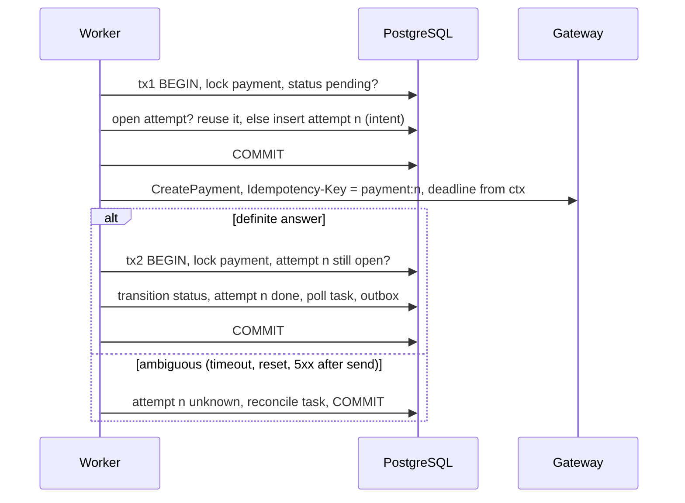

# Proposal 0001: call the gateway outside the database transaction

| | |
| --- | --- |
| Status | Implemented in v2 (`PAYMENTS_START_MODE=two_phase`, the default) |
| Fixes | [REVIEW.md W1](../REVIEW.md) (deliberate v1 trade-off) |
| Summary in the plan | [IMPROVEMENTS.md, item 1](../IMPROVEMENTS.md) |
| Code | [`internal/app/start_two_phase.go`](../../internal/app/start_two_phase.go), [`internal/app/reconcile.go`](../../internal/app/reconcile.go); the v1 start stays in [`internal/app/start.go`](../../internal/app/start.go) |

## Context

`StartPayment` runs one transaction: lock the payment row, call the gateway,
apply the answer, schedule the poll task, write the outbox row, commit. It is
easy to reason about: only one executor works on a payment, and the gateway
answer and its consequences commit together.

The price is paid while the network call is in flight:

| What is held | Consequence |
| --- | --- |
| A pooled database connection | Worker concurrency is capped by the pool size; a slow gateway drains the pool and API reads start waiting for connections |
| The payment's row lock | A webhook for the same payment blocks until the call returns; long-poll readers are fine, writers are not |
| The task lease | A call slower than the lease lets a second worker claim the task and call the gateway again |
| An open transaction | A crash after the gateway executed the payment but before our commit loses the answer; the payment looks untouched (`pending`) |

The last row is the dangerous one. A client of Pinkponies Bank pays a
merchant, the gateway moves the money, our process dies before the commit. On
retry we send the same idempotency key and the gateway, if it deduplicates,
returns the same payment. Correctness depends entirely on that gateway
behaviour, and nothing in our database says that a call may have happened.

## Goals

- No database connection, transaction or row lock is held during network I/O.
- Before the call, the database records that a call is about to happen and
  with which idempotency key.
- After any crash, the stored state says what to check next.
- The public API and the status machine stay the same; clients see no new
  statuses.

Non-goals: changing the poll or webhook flows, multi-gateway routing,
exactly-once delivery.

## Options considered

| Option | Idea | Verdict |
| --- | --- | --- |
| A. Two short transactions around the call, with a recorded attempt | tx1 records the intent and commits, the call runs with no transaction, tx2 applies the answer if the attempt is still current | **Chosen**: removes every held resource, makes the in-between state explicit, small change |
| B. Separate "submit" task after commit | the create path only enqueues; a submit task calls the gateway and enqueues an "apply" task | Same safety as A with one more queue hop and more latency; A can be extended to B later |
| C. Keep v1, add guard rails | separate pool for workers, call timeout shorter than the lease, lower concurrency | Mitigates the pool and lease rows, but not the lost-answer window; useful as a stop-gap only |
| D. Workflow engine | model start, poll and webhook as a durable workflow | Solves it with infrastructure the rest of the service does not need |

## Design

### Data

A new table, additive migration. As proposed (the implemented schema is
[`migrations/00004_gateway_attempts.sql`](../../migrations/00004_gateway_attempts.sql);
it adds a `not_found` count, a partial unique index that allows one open
attempt per payment, and an index for the metrics query):

```sql
CREATE TABLE gateway_attempts (
    payment_id      uuid        NOT NULL REFERENCES payments (id),
    attempt         int         NOT NULL,
    idempotency_key text        NOT NULL UNIQUE,
    state           text        NOT NULL CHECK (state IN ('intent', 'done', 'unknown', 'abandoned')),
    gateway_ref     text,
    created_at      timestamptz NOT NULL DEFAULT now(),
    updated_at      timestamptz NOT NULL DEFAULT now(),
    PRIMARY KEY (payment_id, attempt)
);
CREATE INDEX gateway_attempts_open ON gateway_attempts (updated_at) WHERE state IN ('intent', 'unknown');
```

The idempotency key is `<payment id>:<attempt>`. It is stable for one attempt
and different for a deliberate new attempt. (Implemented differently for
attempt 1, which uses the payment id; see the implementation notes.)

### Flow



`reconcile` asks the gateway for the payment by our reference (or repeats
`CreatePayment` with the same key when the gateway deduplicates). If the
gateway knows it, the answer is applied as in tx2. If the gateway answers
"not found" with certainty after N lookups, the attempt becomes `abandoned`
and a new attempt `n+1` may be created.

### Where it can crash, and what happens

| Crash point | State left behind | Next step | Can the client be charged twice? |
| --- | --- | --- | --- |
| Before tx1 commits | nothing new | task retried, tx1 runs again | no |
| After tx1, before the call | attempt `intent`, no call made | task retried; it reuses the open attempt and its key | no: the first real call happens now |
| After the call, before tx2 | attempt `intent`, gateway may have executed | retry reuses the same key, or reconcile finds the payment | no, if the gateway deduplicates by key: the retry re-sends the reused intent's key without looking up first |
| During tx2 | rolled back to `intent` | as the previous row | no |
| After tx2 | attempt `done`, status applied | nothing | no |

The design needs the gateway to support **both** idempotency keys and lookup
by reference, for different paths. Deduplication by key covers crash row 3:
a reused intent is sent again with the same key. Lookup covers ambiguous
answers, which are settled only by looking the payment up. And abandoning an
attempt after "not found" answers is safe only if the lookup shows a payment
soon after its create call; the duplicate check after the next attempt
detects, but cannot prevent, a payment that shows up later.

### Concurrency

- The task lease still guarantees one executor in the normal case. tx2
  re-locks the payment and applies the answer only if attempt `n` is still
  open, so a late duplicate worker cannot apply a stale answer.
- A webhook can arrive between tx1 and tx2. It is applied through the status
  machine as today. tx2 then sees the newer status, does not regress it, and
  only closes the attempt.
- The call deadline is derived from the task context and kept shorter than
  the lease, so a slow call ends before another worker may claim the task.

## Changes

| Area | Change |
| --- | --- |
| `migrations/` | `00004_gateway_attempts.sql` (00003 was taken by the metrics index) |
| `internal/ports` | `Attempts` port: open, reuse, close, mark unknown |
| `internal/app/start.go` | broken into tx1, call, tx2; new `reconcile` task handler |
| `internal/adapters/out/gateway` | `FindByReference` when the gateway supports it |
| `internal/adapters/out/postgres` | attempts repository |
| `cmd/fakegateway` | fault "execute then drop the connection" (exists as "hang") and a lookup endpoint |
| Config | `PAYMENTS_START_MODE=in_tx|two_phase` during rollout |

## Tests

- Unit, with fakes, one test per crash point in the table above: each injects
  a failure at that point, restarts the handler, and asserts the final state
  and the number of gateway executions.
- Integration on PostgreSQL: two workers race on the same task with an
  expired lease; a webhook lands between tx1 and tx2; a connection-count probe
  shows no connection held while the fake gateway sleeps.
- End-to-end: the fake gateway executes and then drops the connection; the
  payment ends `succeeded` and the gateway reports exactly one execution.

## Rollout

1. Ship the migration and the code behind `PAYMENTS_START_MODE=in_tx` (v1 behaviour).
2. Switch to `two_phase` in the demo compose; compare pool wait time and
   webhook lock wait under the fake gateway's latency fault.
3. Make `two_phase` the default; remove `in_tx` after one release.

Metrics: attempts by state, age of the oldest `intent` or `unknown` attempt
(alert above a few minutes), reconcile outcomes, and pool acquire wait.

## Risks and open questions

- One more intermediate record for operators to understand; it must appear in
  the admin views and in the runbook.
- The reconcile policy (how many lookups before `abandoned`) depends on how
  fast the gateway becomes consistent; it needs a configurable bound.
- Should a payment show `processing` while an attempt is `unknown`? This
  proposal keeps `pending` to avoid promising progress that may not exist.

## Implementation notes

What v2 does where the proposal left a choice, and where it differs. The
second half of the table comes from the independent review of v2.

| Topic | Implementation |
| --- | --- |
| Reconcile | Lookup by reference only (`GET /v1/payments?reference=`), never a repeated create: a lookup can answer "not found" with certainty, a repeated create cannot tell "executed now" from "executed before". |
| Abandoning | After `PAYMENTS_RECONCILE_NOT_FOUND_LIMIT` (3) certain "not found" answers, `PAYMENTS_RECONCILE_INTERVAL` (10 s) apart; the configuration requires the window to cover the worst gateway budget, so no call of ours can still be in flight. A failed lookup is retried and never counted. A new attempt starts through a start task with the dedup key `start:<n+1>`. |
| Several matches | The gateway holds more than one payment for one bank payment: the task goes dead, `gateway_duplicates_detected_total` grows and `GatewayDuplicateCharge` pages. The refund is an operator action; this repository refunds nothing automatically. |
| Unknown attempt and start retries | While an attempt is `unknown`, a start retry never calls the gateway; reconciliation owns the attempt. |
| One open attempt | Enforced by a partial unique index, not only by the row lock. |
| Payment status | Stays `pending` while an attempt is `unknown`, as proposed. |
| Call deadline | The worker's task timeout (30 s), validated to be at least 10 s shorter than the lease (60 s) and 5 s longer than the worst gateway budget, so tx2 or the switch to `unknown` always has time to run. |
| Key of attempt 1 | The payment id, the key the v1 start sends; `<payment id>:<n>` from attempt 2. A v1 call that executed without committing is deduplicated when the two-phase start retries it, so upgrading from v1 cannot charge twice. |
| Switching modes | `in_tx` hands any payment that has attempts to the two-phase start, decided under the payment's row lock. Switching in either direction, at any time, sends no second key for the same call. |
| Gateway event during or after the call | When a payment leaves `pending` with a gateway reference, the event handler closes its open attempt; a start retry for a payment that has left `pending` does the same. A crash after the call followed by the gateway's event no longer leaves an attempt open forever. |
| 409, 425 and a lost connection after writing | 409 ("a request with this key is in progress"), 425 Too Early ("send it again") and a connection error after the request was written (including a dial error from net/http's replay of a request with an `Idempotency-Key`) keep the attempt and its key and retry the task; they never lead to an abandon. |
| Duplicate check | When an attempt that follows an abandoned one settles, a `check_duplicates` task looks the payment up after `PAYMENTS_DUPLICATE_CHECK_DELAY` (10 min). A definite answer that arrives for an abandoned attempt triggers the check at once and is not applied. |
| Attempt cap | `PAYMENTS_MAX_GATEWAY_ATTEMPTS` (3). Past it the task goes dead (`DeadTasks`) and the payment stays `pending` for an operator. |
| Rollout | `two_phase` is the default from the start; `in_tx` remains selectable to compare the two (README, "v1 to v2"). |
| Metrics | `gateway_attempts{state}` for open attempts, `gateway_attempt_oldest_open_seconds`, `reconcile_total{outcome}`, `gateway_duplicates_detected_total`, and the `GatewayAttemptStuck` and `GatewayDuplicateCharge` alerts. |

### Upgrade path

- **From v1.** Deploy v2 with the default `two_phase`. Payments whose v1
  start is waiting for a retry are retried as attempt 1 with the same key the
  v1 call used, so a call that executed before the deploy is deduplicated by
  the gateway. Nothing needs to drain first.
- **Back to `in_tx`.** Payments that have attempts are still finished by the
  two-phase start; only payments without attempts take the v1 path.
- **Mixed versions during a rolling deploy.** Both decide under the
  payment's row lock and send the same key for the first call.

Tests: one unit test per crash-point row above, which restarts the handler
after the crash and checks the final state and that the gateway executed the
payment once; regression tests for each review finding (mode switch in both
directions, crash then event, abandoned attempt that executed late, the
attempt cap, 409 on the same key); integration tests for a webhook during
the call, two workers on an expired lease, concurrent starts and events, the
absence of held connections during the call, and reconciliation on
PostgreSQL; the end-to-end script runs the "execute, then hang" fault in both
modes.

